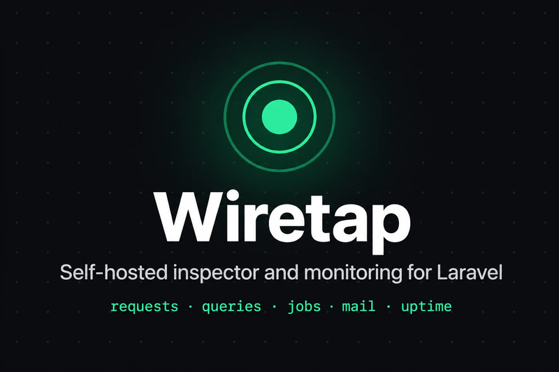
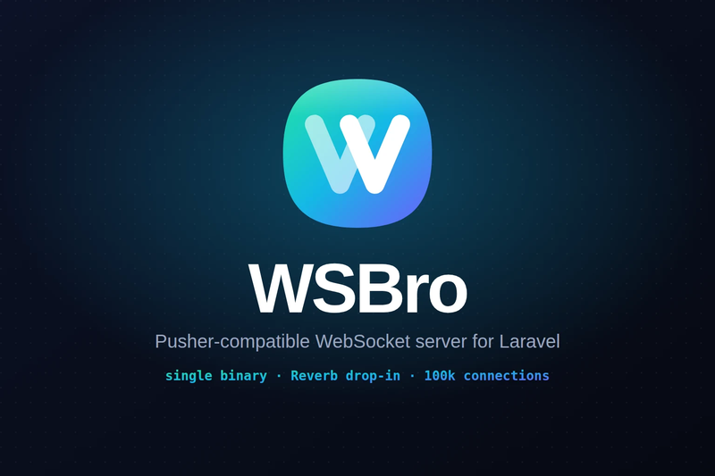
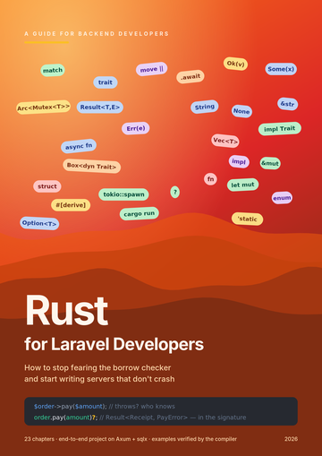
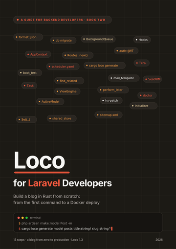

## AxViLab

Open-source tools and books for Laravel developers, by [Vitaly Ax](https://github.com/axvidev).

<table>
  <tr>
    <td width="50%" valign="top">
      
       <b><a href="https://github.com/axvilab/wiretap">Wiretap</a></b>
       Self-hosted inspector and monitoring for Laravel. Request traces, N+1 detection, jobs,
      a mail catcher, uptime and SSL checks. One Docker image plus a zero-config Laravel package.
    </td>
    <td width="50%" valign="top">
      
       <b><a href="https://github.com/axvilab/wsbro">WSBro</a></b>
       Pusher-compatible WebSocket server in Go. Laravel's <code>reverb</code> and <code>pusher</code>
      broadcasters and Echo work unchanged. One 20 MB binary with a live dashboard.
    </td>
  </tr>
</table>

More tools:
- [**laravel-maintenance**](https://github.com/axvilab/laravel-maintenance): advanced maintenance mode
  management for Laravel.
- [**Quipu**](https://github.com/axvilab/quipu): a local app for Claude Code that shows what it reads in
  each project and what that costs.

### Books

  
  &nbsp;
  

Companion code: [rust-for-laravel-devs](https://github.com/axvilab/rust-for-laravel-devs) ·
[loco-for-laravel-devs](https://github.com/axvilab/loco-for-laravel-devs)

Everything else: [axvi.dev](https://axvi.dev)
